# 标题候选

1. **我给孩子写了一个网页，打开就是七个乐园** ← 已采用（排版版即用此标题）
2. 不用装 App、不用注册、断网也能玩：我给自己孩子写了一个网页
3. 不想让他为了玩几张识字卡先交出名字，于是我给自己孩子写了一个网页

> 主推第 1 条。第 2 条适合配「单页面 + 离线可用」两个卖点发，第 3 条偏观点、适合做二条转载。

---

# 我给孩子写了一个网页，打开就是七个乐园

> 我给孩子写了一个网页。不用安装，不用注册，断网也能打开。

给孩子找学习工具的时候，我的第一反应变成了：先别急着装。

应用商店里翻一圈，不是要注册手机号，就是要授权，就是要联网，还时不时弹个广告出来。我也试过几个网页版的，各有各的问题。

后来我想，他每天要的东西其实就那么几样：认几个字，认几个字母，数几个数，听两首诗。这些我自己弄得出来。

**于是我就自己给他写了一个。**

它叫「幼儿学堂」。不是一个 App，也不是一个要记网址的网站——**它就是一个网页，我写给自己的孩子用的。**

## 一、它只是一个网页

不用去应用商店搜，不用下载，不用安装，不用注册，不用登录，不用授权，不用填孩子的生日。

**打开就能用。** 所有的字、图、声音、题目、页面，都在同一个网页里，翻页、跳转全在页面内部完成，不会因为你断网了就缺一块。

这件事落在我们家是三个场景：

- **断网也能玩。** 坐高铁那几个小时；手机流量快用完的下午——他照常打开，一个字都不会少。
- **特别好传。** 发到微信里，能像图片一样转给我爸妈；拷进 U 盘，插到另一台电脑上就继续玩；存到平板桌面，点一下图标就进去，跟 App 一样。
- **干净。** 不弹广告，不跳支付，也没有东西在后台偷偷联网。这一点是我动手的全部理由——**我不想他在玩的时候，被任何东西打断。**

他的名字、他今天认了哪几个字、答对了几道题、攒了多少颗星星，只存在打开它的那台设备上。不上传，不同步。我知道这有个不方便：换设备数据不会自己跟过去，我写了导出和导入，可绑定导出配置，让学习内容实时写入到本地；没有「多端同步」这种听起来很高级的东西。

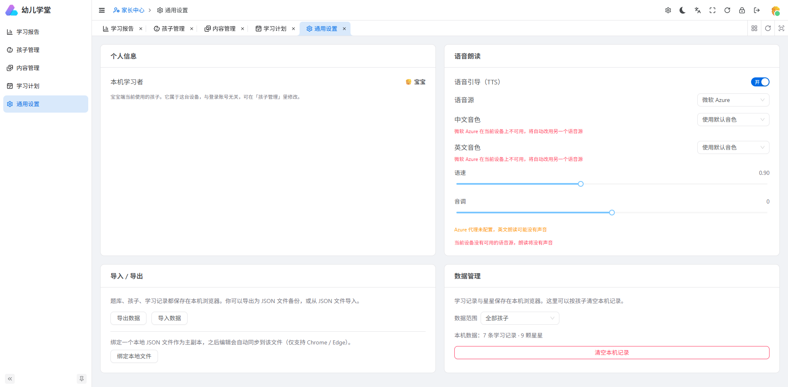

## 二、孩子看到的，是一棵树和一片海

同一个首页，横着拿和竖着拿，是两个样子。这块是我做得最久的。

**竖着拿**，是一棵大树。七个学习入口像木牌一样一块块挂在树枝上，树顶单独挂着一颗星星。

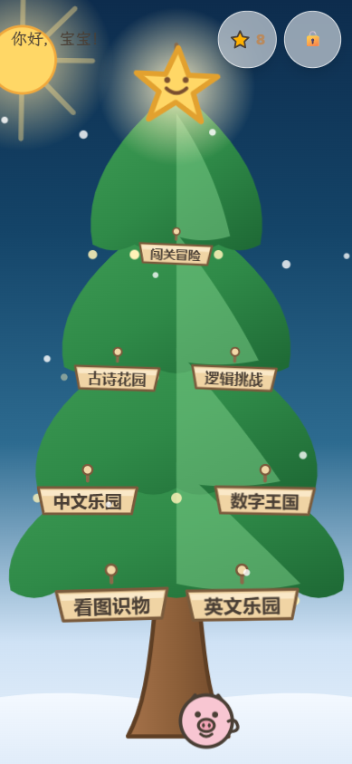

**横过来**，变成一片海。一只小猪在水里游，岛屿散在远近不同的位置，每个岛上有一个入口。

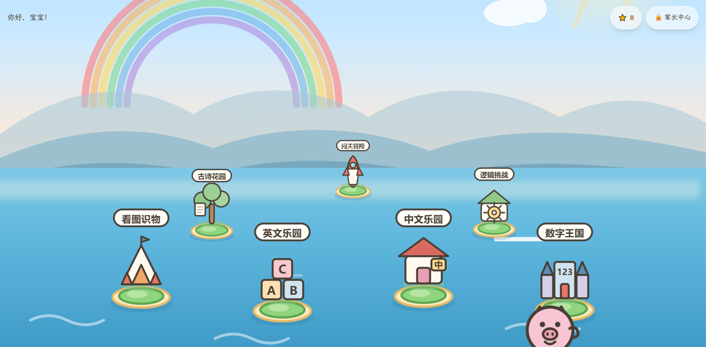

七个入口的名字，我尽量取得像「玩的地方」，不像「课程」：

**看图识物 · 中文乐园 · 英文乐园 · 数字王国 · 古诗花园 · 逻辑挑战 · 闯关冒险**

他还不识字，所以点任何一个地方，都有声音念给他听：

> 你好，宝宝！今天想玩什么呢？
>
> 点一点卡片，听听它是什么？

按钮做得很大。小手指戳不准是常态。

## 三、七个乐园，分别能玩到什么

这是里面的主体。下面每一块都不是「一张图配一句话」，是够他反复玩上一阵子的。

**🐘 看图识物**  
卡片按动物、水果、交通工具、身体部位分类排好。点开一张，有图、有名字、有拼音，还有一句小知识。可以一张张往前翻、往后翻，翻到哪张听哪张。

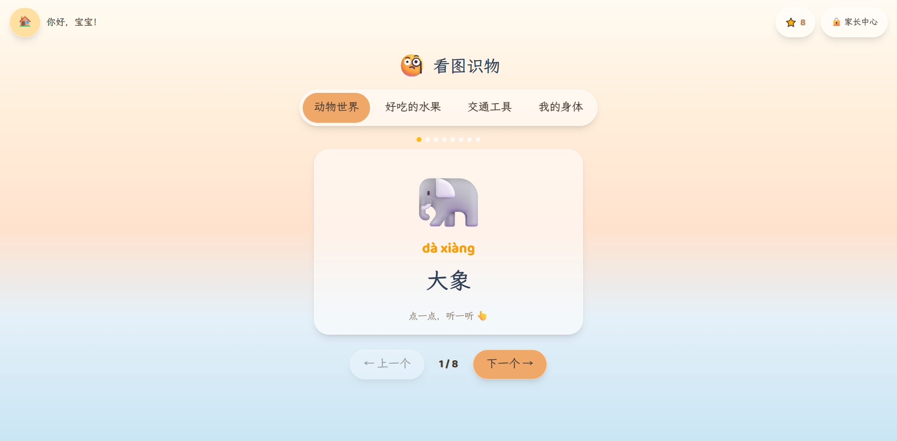

**🅰️ 中文乐园**  
学拼音和认汉字共用一套内容。声母、韵母一个个点着听，听熟了可以「考一考」：屏幕上给出一个拼音，让他在几个汉字里挑出是哪个；反过来，也可以给一个汉字，让他找它的读音。**答错的题会自动进「错题本」，之后专门再考他一遍**，答对了就从本子里划掉。

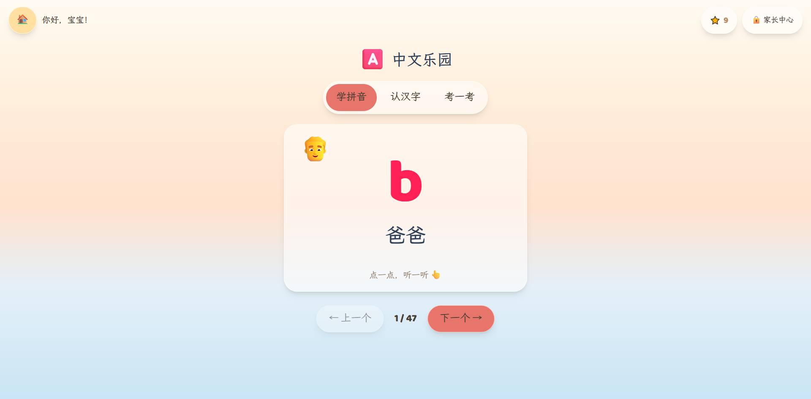

**🔤 英文乐园**  
26 个字母，每个配一个带图的单词和一句完整例句。字母、单词、例句分开学。考试的两种问法也很直接：「字母 A 藏在哪里？」让他在一堆字母里找；「apple 是什么意思？」在一堆图里挑。同样有错题本。

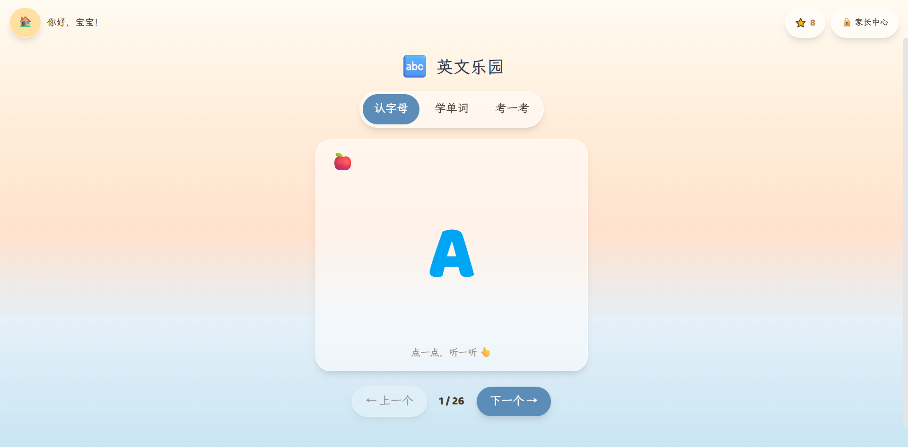

**🔢 数字王国**  
三个玩法：**认一认**——1 到 10，数字、汉字、图形挨个认；**算一算**——10 以内的加减，题目还能往前翻、往后翻，做错了可以回头看看刚才那道是怎么算的；**玩一玩**——问一句「数一数，有几个？」，让他自己数屏幕上的东西。

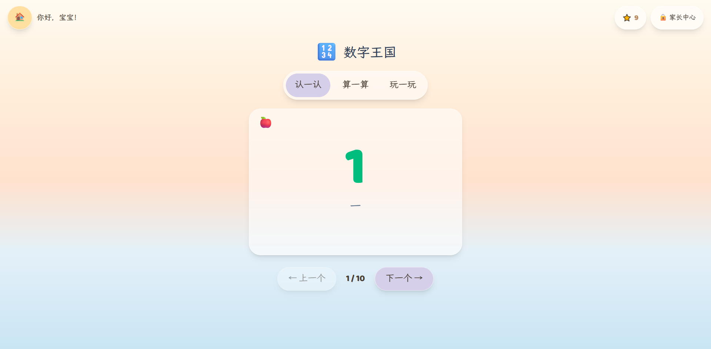

**📜 古诗花园**  
一首诗一页，配图、配拼音。点「朗读全诗」整首念下来，也可以一句一句跟着听，翻上一首、下一首都行。收进来的都是这个年纪真能听懂、能背下来的：静夜思、春晓、咏鹅、悯农、江雪、赠汪伦……

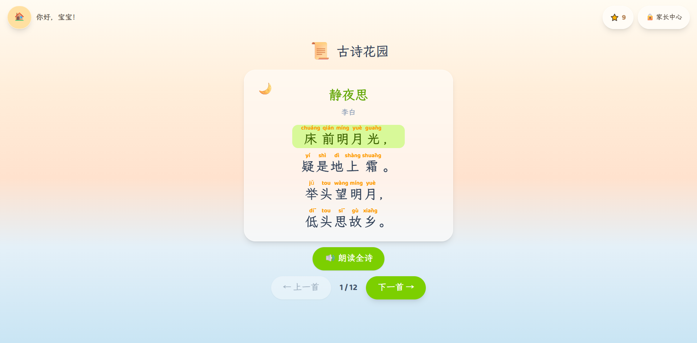

**🧩 逻辑挑战**  
四种题型，和上面几个不一样，这个更「动脑」：**找规律**（下一个该是什么）、**分类归类**（哪个不属于这一类）、**比较排序**（哪个最大、哪个最多）、**配对空间**（谁和谁是一对）。这些题没有答案可背，只能自己想。

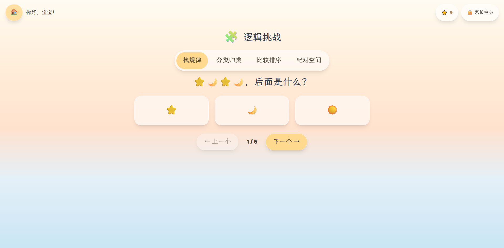

**🗺️ 闯关冒险**  
把上面这些模块的题目混起来，做成五关：小小起步、数字山谷、逻辑森林、智慧山顶、冠军之路。每关几道题，做错了会提示「没关系，我们再来一次吧」，全部做完有句「通关啦！」。他通常会自己想再打一遍。

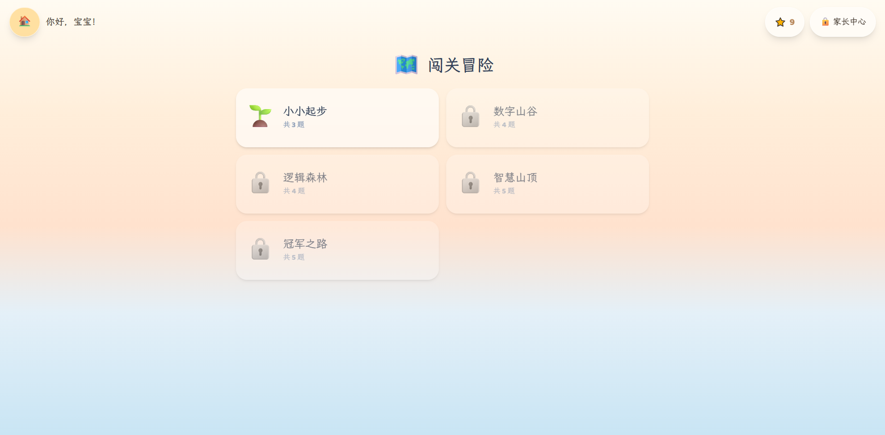

首页树顶那颗星星，点进去是**「我的星星」**：他攒了多少颗星星、今天还有几件事没做完、连续学了多少天、墙上已经点亮了哪几块徽章——都在这一页。

## 四、答错了，我不说「错」

这是我想得最久的一条。

答对了，随机听到一句：「答对啦，真棒！」「太厉害了！」「你真聪明！」「哇，完全正确！」

答错了——「没关系，再试一次！」「差一点点哦，再来！」「加油，你可以的！」

整个宝宝端，不会出现「错误」「失败」「你答错了」这样的词。不是回避，是看着他做题我才明白：一个四岁孩子做错一道题，什么都说明不了；但一句「你怎么又错了」，可能被记很久。

奖励是这样：每次学习攒星星。星星攒到 10 颗、50 颗、100 颗，点亮三枚徽章；学满 20 次、100 次，再点亮两枚。还会记「连续学习了多少天」。今天的任务全部做完，会有一句专门的庆祝，把他的星星总数念出来。

## 五、家长那边，藏在一道乘法题后面

他自己进不去。

宝宝端右上角有个小入口，点进去是一道乘法题。他答不出来，设置就进不去。不用记密码，也不会因为忘了密码反而把自己锁在外面。

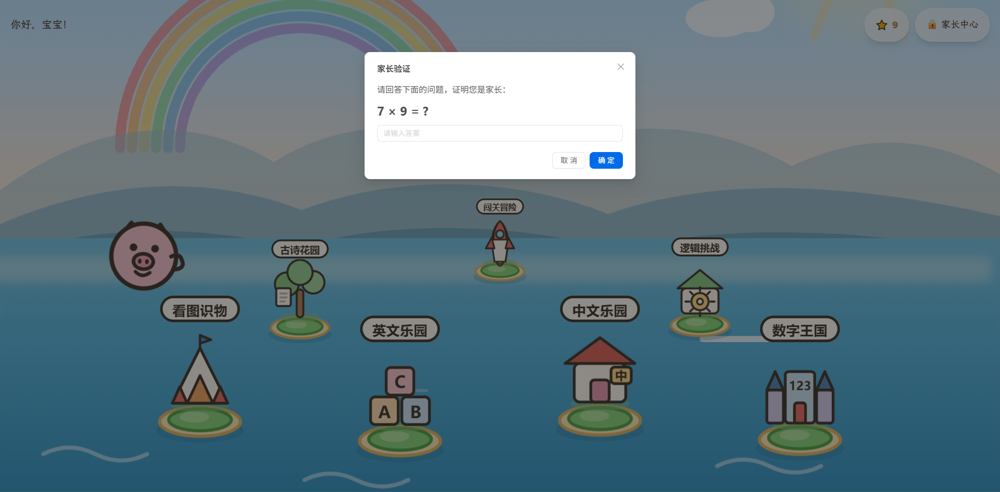

进去之后是五件事：

**学习报告**——累计多少颗星星、一共学了多少次、连续多少天、正向反馈的比例、最近 7 天的趋势、每个模块各花了多少精力。家里两个孩子就分开看，也能合起来看。

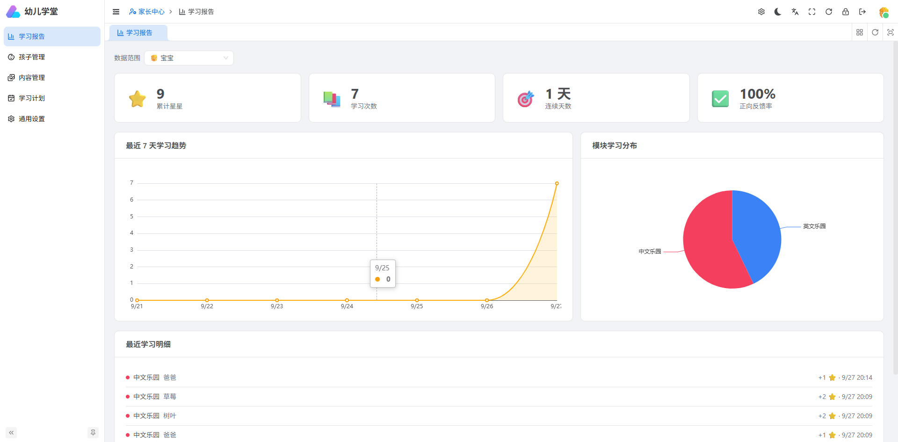

**孩子管理**——一台设备上可以放好几个孩子的档案，各自的记录分开算，切换一下就行。

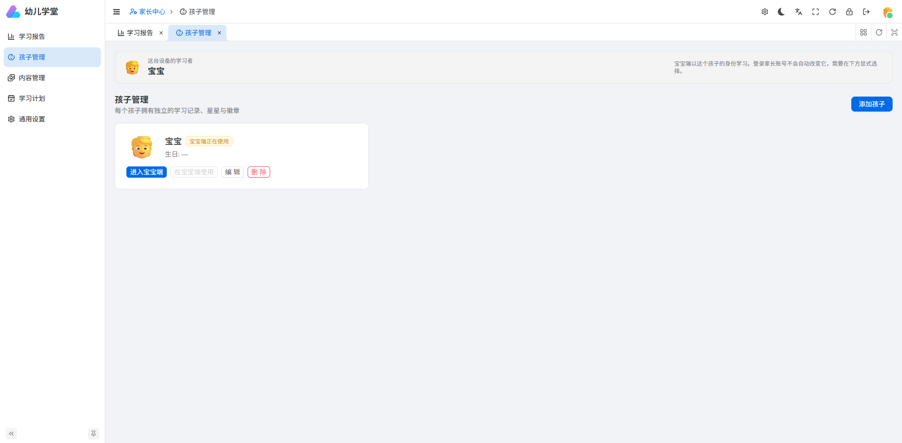

**内容管理**——所有卡片、拼音、汉字、古诗、题目，都能改。改完立刻生效，拼音无需家长自己录入，输入汉字自动转拼音。

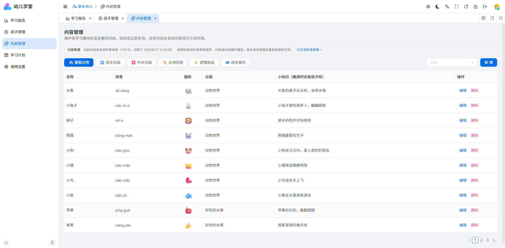

**学习计划**——每个模块每天想让他做几次、难度范围多大（比如英文这阵子只学前 10 个字母）、字母按 A→Z 还是随机打乱、不想要的模块直接关掉（关了首页就不显示）。

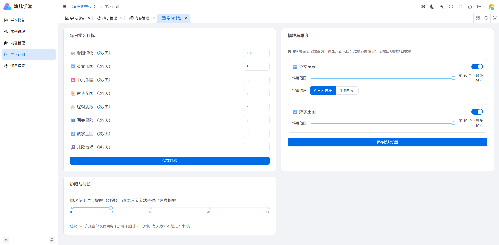

**护眼与时长**——设一个单次时长，超过之后他会听到「小朋友，看了很久啦，让眼睛休息一下吧！」。建议值我直接写在设置里：3-6 岁单次不超过 20 分钟，每天累计不超过 1 小时。写在设置里，是因为最后该由我自己定。

## 六、内容是先按他的进度填的，你可以改成你孩子的

现在里面装了 150 条：

- **看图识物** 26 张卡片——动物、水果、交通工具、身体部位
- **中文乐园** 47 条——声母、韵母、认汉字
- **英文乐园** 26 条——字母、单词、例句
- **古诗花园** 12 首
- **逻辑挑战** 24 题——四种题型都有
- **数字王国** 10 条——数字和数数
- **闯关冒险** 5 关

它们没有写死在程序里，而是来自一张表。你改表，重新生成一次，孩子那边看到的就是新的。

我一开始是按他现在的进度填的。但每个孩子不一样，所以内容留了可以改的口子。这意味着一些有意思的可能：他这周在幼儿园学的那首诗，可以加进去；奶奶常念叨的那句方言童谣，可以加进去；他名字里的那个字，可以做成一张卡片。

**任何现成的东西都难在一个地方：它不认识我的孩子。** 这一块，只能自己填。

## 金句

> 我不想让他为了玩几张识字卡，先得把自己的名字交出去。

## 结尾

它不是 App，所以没得「安装」；它没有服务器，所以也没有「登录以同步」的弹窗。这些不是还没做，是我一开始就决定了不做。

本来只是给我家孩子用的。后来有朋友看见了问能不能也给他家娃一份——可以，拷过去就能用，不用我做什么。

如果你也在给孩子找这样一个小东西，可以找我要一份，打开就是了。

觉得这个思路还行，点个「在看」；身边有同样在跟三四岁小孩斗智斗勇的朋友，也欢迎转给他。

---
